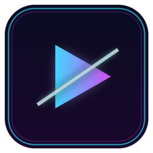

# NOVACUT Studio

**Editor video futuristik berbasis web yang dikemas menjadi aplikasi desktop Windows.**



NOVACUT Studio adalah editor video dengan tampilan futuristik (dark neon UI) yang berjalan 100% di perangkat kamu — tanpa upload ke server, tanpa watermark, tanpa batas durasi.

---

## ✨ Fitur

| Fitur | Keterangan |
| --- | --- |
| 🎬 **Timeline multi-layer** | Layer video, audio, gambar, dan teks. Tambah layer manual kapan saja |
| ✂️ **Editing lengkap** | Potong (split), hapus, salin, snap, drag & drop di timeline |
| ⚡ **Speed & Loop** | Percepat/perlahankan tiap klip (0.25x–4x) dan ulang klip (loop) sebanyak mungkin |
| 💥 **Efek blockbuster** | Film grain, VHS, glitch, letterbox sinema, color grading sinematik, dan lainnya |
| 🔀 **28 transisi gaya trailer Hollywood** | Flash, glitch slide, zoom punch, whip pan, luma fade, dan lainnya |
| 📦 **Export & Split** | Export penuh atau potong otomatis: per N bagian **atau** per N detik |
| 📝 **Teks otomatis 3 kolom** | Judul, deskripsi, dan label Part/Episode ditulis otomatis ke setiap bagian hasil split |
| 🎨 **Cover Studio AI + 100 template** | Cover otomatis dari adegan terbaik video (AI pilih frame) **atau** unggah PNG/JPG sendiri |
| 🌑 **Pilihan latar cover** | Latar cover bisa **hitam polos** atau **adegan dari video** — satu latar untuk semua bagian, atau **tiap bagian adegan berbeda** (AI) |
| 📋 **Menu Export Playlist** | Judul otomatis dari nama video, deskripsi, teks Part/Episode — tombol **Terapkan & Simpan** dipakai lagi untuk video berikutnya |
| 🎵 **20 backsound bebas hak cipta** | Disintesis prosedural (Web Audio) — 100% orisinal, bebas klaim, bekerja offline |
| 🖼️ **Cover otomatis di awal video** | Durasi 2–5 detik, otomatis jadi frame pertama setiap hasil split |
| ▶️ **Playlist** | Impor banyak video sekaligus, ekspor batch semua video di playlist |
| 📐 **Rasio 9:16 / 16:9** | Zoom manual 1–5x + geser atas/bawah/kiri/kanan, tombol ISI FRAME & RESET |
| 🔊 **Export dengan suara** | Audio dari klip, layer musik, dan efek semua tercampur ke file hasil export |

## 📥 Download

Unduh di halaman [**Releases**](../../releases):

| File | Untuk apa |
| --- | --- |
| `NOVACUT-Studio-Setup-1.0.4.exe` | **Installer** — instal seperti aplikasi biasa (pilih folder, ikon desktop, uninstall lewat Control Panel) |
| `NOVACUT-Studio-Portable-1.0.4.exe` | **Portable** — satu file, jalankan langsung tanpa instalasi. Bisa disimpan di flashdisk |

> Hasil export berformat **MP4 (H.264)** — otomatis tersimpan ke folder pilihanmu (fitur *Pilih Folder* di menu Export), dan juga bisa diunduh ulang dari daftar hasil di dalam aplikasi. Judul/teks panjang otomatis turun ke baris bawah agar seluruhnya terbaca.

### Catatan antivirus / SmartScreen

File installer & portable **tidak ditandatangani secara digital** (code signing berbayar), jadi Windows SmartScreen mungkin menampilkan peringatan saat pertama kali dijalankan. Pilih **More info → Run anyway**. Ini normal untuk aplikasi open-source tanpa sertifikat.

## 🚀 Menjalankan dari source (mode web)

```bash
bun install
bun run dev        # buka http://localhost:3000
```

## 🖥️ Build aplikasi desktop (Windows)

```bash
bun install
bun run build:desktop   # static export ke folder out/
bun run desktop         # electron-builder -> release/win-unpacked
# lalu kompilasi installer & portable (makensis):
NSISDIR=<nsis-data> makensis scripts/nsis/setup.nsi
NSISDIR=<nsis-data> makensis scripts/nsis/portable.nsi
```

Atau gunakan GitHub Actions: workflow `.github/workflows/build-desktop.yml` otomatis membangun `.exe` di Windows runner.

## 🧑‍💻 Teknologi

- **Next.js 16 + React 19 + TypeScript + Tailwind CSS**
- **Canvas 2D** render engine + **Web Audio API** (mixing audio & sintesis musik)
- **MediaRecorder** untuk export video (video + audio)
- **Electron** untuk pembungkus desktop
- **Zustand** state management

## 📄 Lisensi

MIT — lihat [LICENSE](LICENSE).
